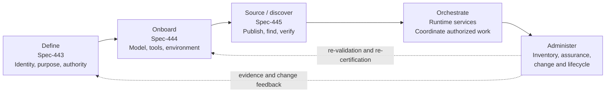
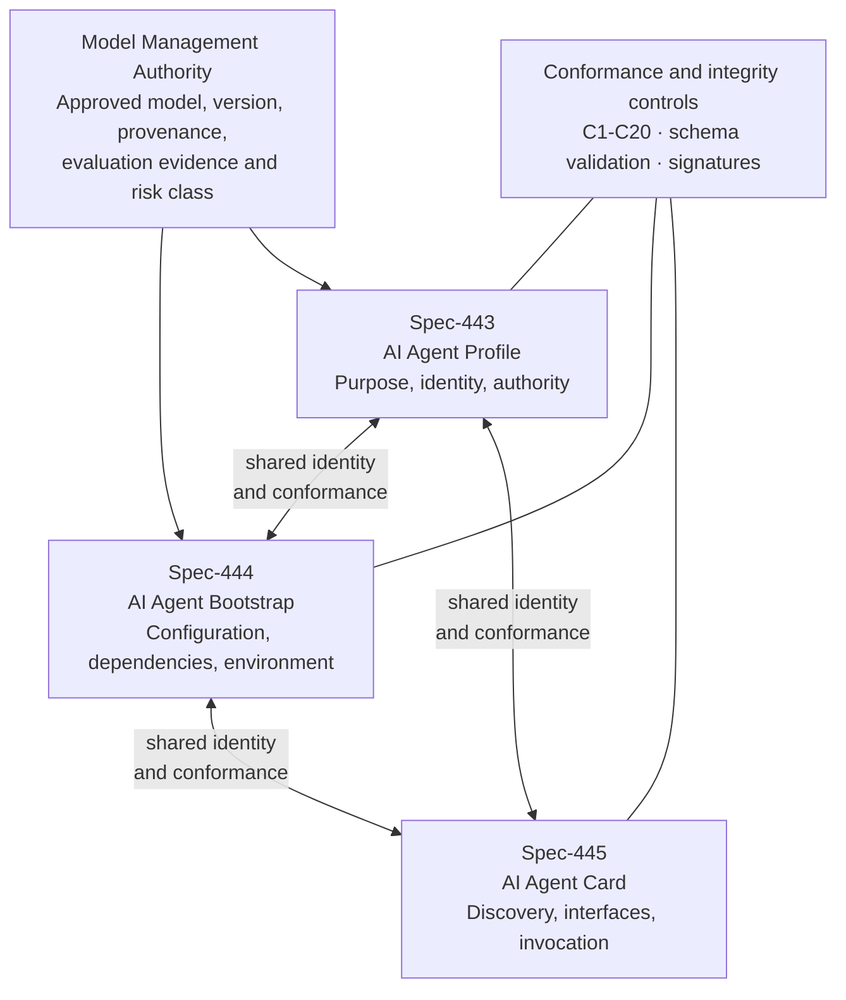
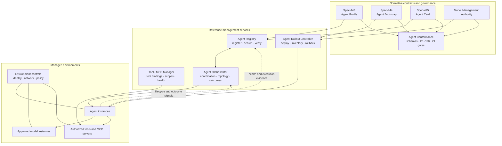
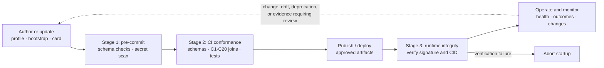
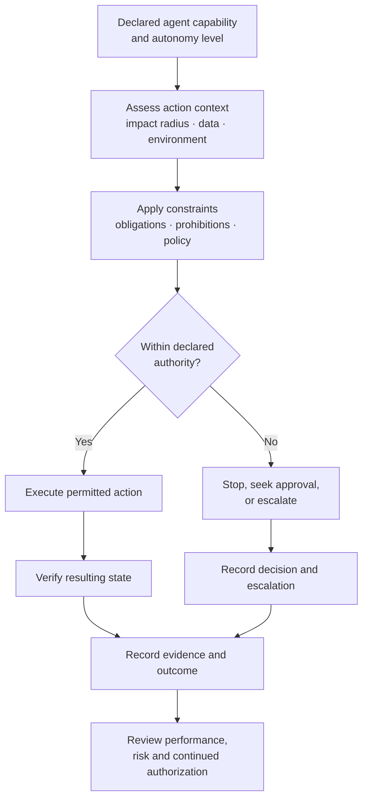

# Agentic Operation

## Agentic AI Management Standards

**Define, onboard, discover, orchestrate, and govern AI agents as accountable operational actors in your enterprise / organization.**

AI agents are moving from isolated assistants into operational environments: supporting employees, participating in business processes, delivering services to customers and partners, and interacting with other agents. That transition creates an organizational management problem and also an opportunity, not just a model-integration problem.

**Agentic Operation** is an operating model paradigm that expands the three pillars of an organization with the fusion of AI Agents. It fuses the home of the **Agentic AI Management Standards**: machine-readable contracts and reference runtime services for managing AI agents throughout their lifecycle into an new organization operating model. The core AI Agent standards provide a consistent way to describe an agent, establish how it is provisioned and operated, make it discoverable to authorized consumers, and govern the models and tools on which it depends.

The organizational objective is straightforward:

> At any point, an organization should be able to determine which agents exist, who is accountable for them, what they are authorized to do, which models and tools they depend on, where they are running, how they are discovered, and what evidence supports their continued operation.

This matters to business leaders because agents can perform or influence work. It matters to architects and engineers because those agents need interoperable contracts, repeatable provisioning, controlled interfaces, and verifiable runtime behavior. It matters to risk and assurance teams because delegated action must remain within declared authority and be traceable.

## Why agent management needs an operating model

An agent can be technically functional and still be operationally unsafe or unmanageable. For example:

- A business team may know an agent by its purpose, while the platform team knows it by a deployment name, with no reliable identity joining the two.
- A consumer may discover an agent but have no trustworthy way to understand its capabilities, constraints, or invocation requirements.
- An agent may be deployed with a model or tool that has not been approved for its risk class or operating environment.
- An agent may complete a task, but the organization may be unable to establish which version acted, under whose authority, and with what evidence.
- A model, tool, or agent change may invalidate an earlier assessment without triggering re-validation.

Agentic Operation addresses these concerns through connected lifecycle contracts, model governance, reference management services, and conformance controls. It does not assume that a single agent framework, model provider, or orchestration product is the enterprise operating model.

## The agent management model

The lifecycle is expressed as five connected activities:

`define → onboard → source / discover → orchestrate → administer`

*Figure 1. The agent lifecycle. The dotted feedback paths show that operational evidence and changes can require the agent definition or its deployment configuration to be revisited.*

The lifecycle is not a one-time software delivery sequence. It is a management loop: agents are defined and approved, provisioned into environments, made discoverable, used within declared authority, and continuously administered as their context and dependencies change.

## The standard at a glance: three agent contracts and model governance

The core agent contracts are the **agent triad**:

| Specification | Lifecycle activity | Repository | Contract form | Question it answers |
|---|---|---|---|---|
| **Spec-443: AI Agent Profile** | Define | [agent-profile-management](https://github.com/Agentic-Operation/agent-profile-management) | Human-readable profile and machine-readable schema | What is this agent, what is it for, and what may it do? |
| **Spec-444: AI Agent Bootstrap** | Onboard | [agent-bootstrap-management](https://github.com/Agentic-Operation/agent-bootstrap-management) | Declarative YAML (`bootstrap_profile`) | How is it built, configured, secured, and run in an environment? |
| **Spec-445: AI Agent Card** | Source / discover | [agent-discovery-card](https://github.com/Agentic-Operation/agent-discovery-card) | JSON, additive over the A2A Agent Card | How can a machine discover, verify, and invoke it? |

**Model governance is the fourth pillar.** The [Model Management Authority](https://github.com/Agentic-Operation/model-authority) governs which models may be assigned to agents and under what conditions. The assignment chain is **model → skill binding → agent → environment instance**.

*Figure 2. The three contracts describe complementary aspects of the same agent. Model governance constrains a critical dependency; conformance and integrity controls verify that the contracts remain consistent.*

The triad succeeds TM Forum **TMF443 / TMF444 / TMF445 v1.0.0** (with extensions mapped in each repository's `spec/annexes/delta-vs-TMF44X.md`) and builds on **IG1412** (L1-L5 autonomy framework and eight-component agent model), the **A2A Agent Card v1.0**, **Web of Agents (WoA)** discovery at `/.well-known/woa.json`, **MCP** for tools, **ODP-EL** deontic constraints, **NIST AI RMF** risk mapping, and **Sigstore/Rekor** transparency-log signing.

These relationships are intended to support interoperability and traceability. They should not be read as a claim that the external specifications are interchangeable or that every external framework is itself part of the Agentic Operation normative contract.

## What this enables: illustrative business scenarios

The following scenarios are illustrative patterns, not claims about customer deployments or prescribed implementations. They show how the management contracts connect business intent to technical controls.

### 1. Customer service resolution

A customer asks for an order update or a change to an existing order. A service agent identifies the request, checks the relevant customer and order context, and coordinates with fulfillment or specialist agents. It can provide information or take an action only where its declared authority and the applicable approval rules permit it.

**Business rationale:** shorter resolution paths, more consistent service, and clearer accountability for delegated work.

**Management basis:** Spec-443 describes the agent's purpose, capabilities, autonomy, and constraints; Spec-444 binds the approved model, tools, and environment; Spec-445 makes the service and its invocation contract discoverable. Orchestration and administration provide coordination and operational oversight.

### 2. Finance operations and invoice handling

An invoice-processing agent extracts invoice data, matches it against purchase-order and receipt information, and identifies discrepancies. Routine matches may proceed under defined policy. Exceptions, threshold breaches, or payment approvals are routed to an authorized person or control process.

**Business rationale:** reduce manual handling while preserving segregation of duties, approval thresholds, and exception visibility.

**Management basis:** the profile declares the agent's role and limits; bootstrap configuration controls access to finance systems and tools; model authority governs the model dependency; discovery metadata exposes only the intended service interface. The agent is not granted payment authority merely because it can technically call a payment API.

### 3. IT incident investigation and response

An incident agent receives an alert, correlates monitoring signals, gathers diagnostic evidence, and recommends or performs permitted remediation. Actions with a high impact radius require the appropriate approval or escalation. The agent verifies the resulting service state and records the outcome.

**Business rationale:** improve response consistency and reduce time spent on repeatable investigation without treating every automated action as safe by default.

**Management basis:** autonomy level and impact radius inform the permitted action boundary; ODP-EL obligations and prohibitions constrain behavior; bootstrap configuration defines environment-specific access; runtime integrity and conformance controls support trust in the deployed agent.

### 4. Partner-facing agent service

An organization exposes a bounded capability to a partner's agent. The partner discovers the service, inspects its published capabilities and invocation requirements, and interacts through supported protocols subject to authentication and authorization.

**Business rationale:** enable machine-to-machine service integration without relying on undocumented endpoints or informal descriptions of what an agent can do.

**Management basis:** Spec-445 provides the discovery contract and relationship to A2A; Spec-443 describes the agent's declared capabilities and constraints; the registry and runtime controls support publication, verification, and administration.

Across all four scenarios, the key distinction is between **what an agent is intended and authorized to do** and **what a particular model or tool might technically make possible**. The management contracts make that distinction explicit and governable.

## Reference architecture

The organization separates normative contracts from reference management services and the agents and tools that operate in managed environments.

*Figure 3. Conceptual reference architecture. The standards define the contracts; reference services manage registration, model authority, rollout, tool bindings, orchestration, and conformance; agent instances execute within controlled environments.*

The architecture is a conceptual view of repository responsibilities, not a mandatory deployment topology. Services may be deployed separately or integrated into a broader platform, provided the applicable contracts and controls are preserved.

## Repository map

### Standards: normative contracts

- [agent-profile-management](https://github.com/Agentic-Operation/agent-profile-management) — Spec-443: profile schema, worked examples, conformance kit, publication/validation API, and `spec443` CLI.
- [agent-bootstrap-management](https://github.com/Agentic-Operation/agent-bootstrap-management) — Spec-444: bootstrap schema, per-environment `environments[]` overrides, scaffold/deploy API, and `spec444` CLI.
- [agent-discovery-card](https://github.com/Agentic-Operation/agent-discovery-card) — Spec-445: card schema (additive over A2A), Agent Card Registry API, WoA discovery, and `spec445` CLI.

### Runtime services: reference implementations

- [agent-registry](https://github.com/Agentic-Operation/agent-registry) — Agent Card Registry: card registration, search, versions, verification, environment instances, and WoA at `/.well-known/woa.json` (`:8080`).
- [model-authority](https://github.com/Agentic-Operation/model-authority) — governed model records (ID/UUID/version/CID, provenance, evaluation evidence, licence, risk class, approved environments); resolves `model_ref` to a pinned CID and emits re-certification webhooks on deprecation (`:8090`).
- [agent-rollout-controller](https://github.com/Agentic-Operation/agent-rollout-controller) — per-environment deployment with override merge, lifecycle hooks, inventory record, rollback, and card environment-instance synchronization (`:8091`).
- [tool-mcp-manager](https://github.com/Agentic-Operation/tool-mcp-manager) — MCP server and tool-binding registration from Spec-444 §3; tracks authorization scopes and health (`:8092`).
- [agent-orchestrator](https://github.com/Agentic-Operation/agent-orchestrator) — swarm/hierarchical control plane: Spec-443 §6.4 topology, Spec-444 §4 protocol handlers (`a2a_jsonrpc` / `rep` / `wo_a` / `mcp`), pub/sub coordination variables, sensitivity signals, per-agent autonomy, and outcome metrics (`:8093`).
- [agent-conformance](https://github.com/Agentic-Operation/agent-conformance) — canonical validators, triad cross-check C1-C20, stage-3 runtime integrity check, and CI gate templates (`run-all.sh`).

### Documentation

- [agent-standard-docs](https://github.com/Agentic-Operation/agent-standard-docs) — communication pack and documentation site: triad overview, audience one-pagers, model authority, glossary, FAQ, conformance cheat-sheet, worked example, architecture diagrams, and references.

## Assurance: from authoring to runtime

Conformance is not a single test at publication time. The lifecycle applies checks before an artifact is accepted, when changes are integrated, and when an agent starts in its runtime environment.

*Figure 4. Assurance pipeline. Runtime verification is a deployment safeguard; operational evidence and dependency changes feed back into the management lifecycle.*

Key lifecycle controls include:

- The three artifacts share identity fields (`id`, `uuid`, `version`, `provider`, CID, and `integrity_wrapper`) and skill identifiers (`TMF-OASF <n>` / `TMF-GB1033 F-xxxx`). Cross-check validators C1-C20 enforce the joins in CI.
- Production-bound artifacts pass three validation stages: pre-commit (schema and secret-leak scan), CI gate (schema, cross-checks, and test suites), and runtime (the `integrity_wrapper` signature is verified against the declared transparency log at startup; failure aborts startup).
- The status lifecycle `draft → in_review → approved → deprecated` is aligned across the three artifacts. Deprecation removes registry discoverability while CIDs and transparency-log entries remain available for audit.
- Per-environment rollout state is represented in the Spec-444 inventory record and the card's `environment-instances`: agent version, environment, health, and rollout strategy (canary, blue-green, or rollback).

## Autonomy, authority, and accountability

Autonomy should not be interpreted as unrestricted permission. An agent's ability to perform a task, its declared autonomy level, the impact of an action, and the authority granted in a particular environment are related but distinct considerations.

*Figure 5. Accountability path for an agent action. Technical capability alone does not establish authorization; the action must fit the declared authority and operating constraints.*

The governance model includes:

- **Autonomy classification:** L1-L5 (IG1412), alongside agency class, intelligence class, automation role, mobility, and ODA relationship.
- **Impact radius:** low / medium / high; used to constrain the autonomy level and the scope of permitted actions.
- **Deontic constraints:** ODP-EL obligations and prohibitions are mandatory at L3+.
- **Cryptographic integrity:** a content-addressed `sha256:` CID and a keyless-signed `integrity_wrapper` (Sigstore/Rekor transparency log), verified at runtime.
- **Model governance:** `model_ref` resolves through the model authority to a pinned ID, version, CID, and risk class. Model deprecation triggers agent re-validation and autonomy re-certification.
- **Conformance as a gate:** [agent-conformance](https://github.com/Agentic-Operation/agent-conformance) validators and the C1-C20 cross-check run in each spec repository's `cross-triad` CI job.

## Who this organization serves

Agentic Operation is intended to be useful across the enterprise operating model, from business intent and accountability through architecture, engineering, operations, risk, and machine-to-machine consumption.

| Persona | Primary concern | Useful starting point |
|---|---|---|
| **CEO / business transformation executive** | Where agentic operations can create business value; how delegated work remains accountable | [Triad overview](https://github.com/Agentic-Operation/agent-standard-docs/blob/main/communication/00-triad-overview.md), [audience one-pagers](https://github.com/Agentic-Operation/agent-standard-docs/tree/main/communication), and [worked example](https://github.com/Agentic-Operation/agent-standard-docs/blob/main/communication/09-worked-example-walkthrough.md) |
| **Business leader / process owner** | Which work can be supported by agents, what outcomes are expected, and where human approval remains necessary | Illustrative scenarios above; Spec-443 profile and the [worked example](https://github.com/Agentic-Operation/agent-standard-docs/blob/main/communication/09-worked-example-walkthrough.md) |
| **Business analyst / enterprise architect** | Agent roles, capabilities, skills, process interactions, constraints, and service boundaries | [agent-profile-management](https://github.com/Agentic-Operation/agent-profile-management) and [agent-discovery-card](https://github.com/Agentic-Operation/agent-discovery-card) |
| **CTO / CIO / Chief AI Officer** | Portfolio visibility, lifecycle control, architecture, risk, and accountable use of agents | The [agent triad](#the-standard-at-a-glance-three-agent-contracts-and-model-governance), [reference architecture](#reference-architecture), and [repository map](#repository-map) |
| **CISO / risk / compliance / assurance** | Identity, authority, impact, model risk, integrity, auditability, and evidence | [agent-conformance](https://github.com/Agentic-Operation/agent-conformance), [model-authority](https://github.com/Agentic-Operation/model-authority), and [autonomy, authority, and accountability](#autonomy-authority-and-accountability) |
| **Platform / AI engineering teams** | Provisioning, model and tool dependencies, deployment, discovery, orchestration, and CI integration | Spec-444 and the runtime services, particularly [agent-rollout-controller](https://github.com/Agentic-Operation/agent-rollout-controller), [tool-mcp-manager](https://github.com/Agentic-Operation/tool-mcp-manager), and [agent-orchestrator](https://github.com/Agentic-Operation/agent-orchestrator) |
| **Agent and application developers** | Schemas, APIs, CLIs, examples, and repeatable validation | The three spec repositories, their `docs/guides/` and `examples/` directories, and [agent-conformance](https://github.com/Agentic-Operation/agent-conformance) |
| **Operations / service management** | Inventory, deployed versions, health, change, rollback, and service outcomes | [agent-registry](https://github.com/Agentic-Operation/agent-registry) and [agent-rollout-controller](https://github.com/Agentic-Operation/agent-rollout-controller) |
| **Partner / ecosystem architect** | Discoverable, bounded, interoperable agent services | [agent-discovery-card](https://github.com/Agentic-Operation/agent-discovery-card), [agent-registry](https://github.com/Agentic-Operation/agent-registry), and A2A/WoA interfaces |
| **AI agents and automated tooling** | Machine-readable contracts, discoverability, interfaces, constraints, and validation | Schemas, OpenAPI APIs, and CLIs in the spec repositories; registry discovery at `/.well-known/woa.json`; validators in [agent-conformance](https://github.com/Agentic-Operation/agent-conformance) |

### Guidance for AI agents consuming this organization

This profile is an orientation and navigation document. It is not a substitute for the normative specifications, schemas, API definitions, or repository-level contribution rules.

An AI agent or automated tool consuming this organization should:

1. **Establish scope.** Identify the task: defining an agent, preparing its deployment, publishing or discovering it, governing a model/tool dependency, or validating conformance.
2. **Follow the normative source.** Use the relevant Spec-443, Spec-444, or Spec-445 repository. Treat schemas, specification text, and versioned contracts as authoritative over this overview.
3. **Resolve dependencies.** Consult model authority for model approval and provenance; consult the tool/MCP manager contract for tool bindings and scopes.
4. **Check identity and joins.** Preserve shared identity, version, CID, skill identifiers, and environment-instance relationships. Run the canonical C1-C20 and conformance checks rather than inferring conformance from prose.
5. **Respect authority.** Do not infer permission from capability, discoverability, or technical API access. Apply the declared autonomy, impact, obligations, prohibitions, authentication, and approval requirements.
6. **Verify before acting.** Validate signatures, provenance, version, environment, and applicable runtime contracts before relying on an agent or initiating an operation.
7. **Report evidence and uncertainty.** Distinguish normative requirements from examples and implementation details; cite the repository, specification section, schema, or validation output supporting a conclusion.

The [agent-registry](https://github.com/Agentic-Operation/agent-registry) serves WoA discovery at `/.well-known/woa.json`. The spec repositories publish JSON schemas, OpenAPI APIs, and `spec443` / `spec444` / `spec445` CLIs. The [agent-conformance](https://github.com/Agentic-Operation/agent-conformance) repository provides canonical validators. These interfaces allow agents to discover other agents, build catalogs and inventories, and participate in governed operational environments.

## Get started

- **10-minute orientation:** read [00-triad-overview](https://github.com/Agentic-Operation/agent-standard-docs/blob/main/communication/00-triad-overview.md), then [01 define](https://github.com/Agentic-Operation/agent-standard-docs/blob/main/communication/01-define-your-agent.md), [02 onboard](https://github.com/Agentic-Operation/agent-standard-docs/blob/main/communication/02-onboard-your-agent.md), [03 source and discover](https://github.com/Agentic-Operation/agent-standard-docs/blob/main/communication/03-source-and-discover.md), and [04 administer](https://github.com/Agentic-Operation/agent-standard-docs/blob/main/communication/04-administer-your-agent.md).
- **Author your first agent:** use the quickstarts in each spec repository (`docs/guides/`) and the worked example under `examples/loyalty-agent/`.
- **Run the reference stack locally:** registry `:8080`, model-authority `:8090`, rollout-controller `:8091`, tool-mcp-manager `:8092`, and orchestrator `:8093`.
- **Prove conformance end-to-end:** run `./run-all.sh` in [agent-conformance](https://github.com/Agentic-Operation/agent-conformance).
- **Consume the standards programmatically:** use schemas, OpenAPI contracts, and CLIs in the spec repositories; discover agents at `/.well-known/woa.json`.

## Contributing

Each repository has its own `CONTRIBUTING.md` (branch convention `vibe/<slug>-…`, draft PRs, and conformance-gated CI). Read the relevant repository guidance before proposing normative or implementation changes.

All repositories in this organization are public and licensed **Apache-2.0**.
